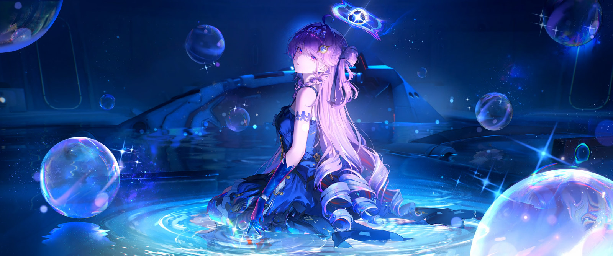
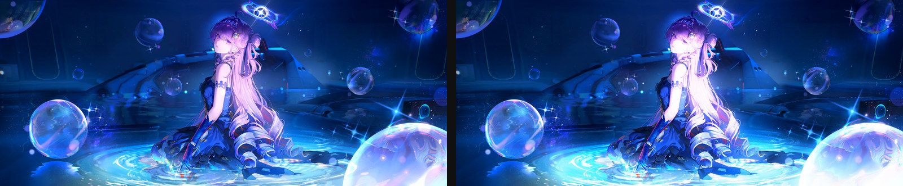
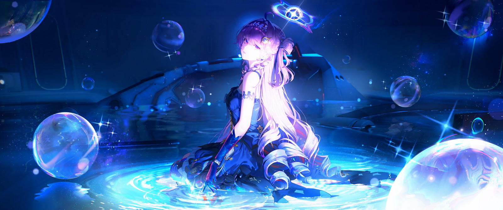

**Turn 8-bit SDR illustrations into HDR masters**: one command produces Ultra HDR JPEG, 16-bit PNG, 10/12-bit HEIC and 12-bit AVIF. There are no presets — the gain parameters are derived from each image's own light distribution.

**Version: Beta 0.1.0** (first public beta).

## Examples

Source `1777789210281_x4_animejanai.png` (12960×5420, 8-bit SDR):



Left: SDR source; right: an approximate SDR-screen preview of the HDR master produced by this tool (`gainmap.render_preview`). The preview shows *where* the lift happens, not the real luminance on an HDR display. Water ripples, bubble rims, hair highlights and sparkles gain; the night sky and shadows stay put:



HDR preview on its own:



Full-resolution gain map written by `--gain-fullres --debug`. Whiter means more lift: water ripples, hair and bubble highlights gain; the night sky and shadows stay near zero:


The gain map is half-resolution by default; decode with `gain = 2 ** (pixel / 255 * GainMapMax)` and HDR linear = SDR linear × gain.

## How it works: one gain curve, five containers

SDR pixels are linearised with the sRGB EOTF to `L_sdr`, multiplied by one scalar gain `g` to give `L_hdr = g · L_sdr`, converted to BT.2020 and encoded as PQ or HLG. All five deliverables share this curve; only the container, bit depth and chroma sampling differ, so "what glows" is identical across formats. `g = 2 ** (gmax · em)` with `em ∈ [0, 1)`, so gain spans `[1, 2**gmax)`; `gmax` comes from the image's own exposure percentiles.

* **PQ is absolute**: `L_hdr` is scaled with SDR white = 203 nits into cd/m² and encoded. 203 nits is PQ code ≈ 0.58, so a PQ file shown in an SDR viewer looks grey — not a broken file, just no HDR rendering path.
* **HLG is relative**: SDR white sits near 75% and the display applies its own OOTF (this tool encodes against a 1000-nit peak). HLG displays with SDR compatibility can show it directly, at the cost of a less controllable peak.
* **Ultra HDR stores no second HDR image**: it is an 8-bit SDR base plus an 8-bit gain map. The map is normalised in log2 to `[0, GainMapMax]` (here `GainMapMax ≈ 1.45` EV); the decoder interpolates by display headroom and multiplies it back into SDR. Old viewers see only the base; HDR devices read the gain map.

## Five outputs

| Format   | Depth / codec                                          | Typical use                                          |
| -------- | ------------------------------------------------------ | ---------------------------------------------------- |
| `jpeg`   | 8-bit sRGB base + 8-bit gain map, MPF + XMP `hdrgm`    | Native HDR on Android, `.jpeg` suffix                |
| `png`    | 16-bit RGB + PQ or HLG (`cICP 9/16/0/1` or `9/18/0/1`) | Lossless master, post-production exchange            |
| `heic10` | 10-bit HEVC Main10 (`nclx 9/16/9`)                     | Best compatibility (Windows / macOS / iOS / Android) |
| `heic12` | 12-bit HEVC Main12 (`nclx 9/16/9`)                     | Highest depth, needs decoder support                 |
| `avif`   | 12-bit AV1 4:4:4 (preferred; `nclx 9/16/9`)            | Small files, web / sharing                           |

All five share **one gain curve**; only the container, bit depth and codec differ. The Ultra HDR gain map is half-resolution by default (`--gain-fullres` keeps it full-resolution), while the other formats are encoded from the same 16-bit intermediate.

## What it solves

Inverse tone mapping (ITM) models trained on photographs tend to fail on flat-shaded anime art: blotchy gain on flat fills, whole line-art strokes glowing, pure whites clipping. SDR illustrations have **already clipped their highlights**; there is no hidden detail to recover.

The goal is therefore not to restore highlight detail, but to decide whether a pixel is *emitting light*, and to lift only those areas on an HDR display:

* **Emitters** (lamps, sparkles, catchlights, bright hair highlights) get a clear boost;
* **Lit surfaces** get a small boost;
* **Large already-bright areas** such as white hair, walls and skin are left mostly alone.

## How it works

The pipeline lives in `hdrgainmap/gainmap.py` and `hdrgainmap/light.py`.

### 1. Adaptive exposure parameters

Fixed thresholds fail across exposures: in a night scene 0.6 is already a bright highlight, while a white wall in daylight is 0.9. The image's own luminance percentiles estimate the overall exposure:

```python
t        = clip(p50 / 0.60, 0, 1)                 # 0 = night, 1 = high-key
gmax     = min((2.2 - 0.6*t) * 0.70, 1.45)        # maximum boost in EV
halo     = 0.16 - 0.06*t                          # bloom share
hr       = max(1, round(3 - 2*t))                 # bloom radius in pixels
base_lit = 0.78 - 0.16*t                          # base weight for lit areas
```

`PEAK_SCALE = 0.70` and `GMAX_CAP = 1.45` are empirical limits: above roughly 1.6 EV, some phones show black blotches in highlights, so the peak is deliberately conservative. `lift` stays at 1.0 — there is no global lift, only light-lit regions move.

### 2. Four cues for "is this emitting?"

```python
illum = gauss(Y, min(h, w) // 25)                 # low-frequency illumination field
lit   = smoothstep(p38(illum), p99(illum), illum) # regions that are lit

peak  = Y / (gauss(Y, 25) + 1e-4)                 # brighter than the neighbourhood
spark = smoothstep(1.45, 2.90, peak)              # small, sharp highlights

area  = gauss(lit, min(h, w) // 8)                # area covered by "lit"
pen   = 0.55 * smoothstep(0.35, 0.85, area) * (1 - 0.7 * spark)
lit  *= 1 - pen                                   # suppress walls / sky

irr   = smoothstep(0.35, 0.85, irradiance(Y))     # propagation / diffuse
ao    = clip((near + 0.02) / (far + 0.02), 0.45, 1.0) ** 0.9
amb   = 0.10 * smoothstep(0.02, 0.45, far) * ao   # ambient
white = smoothstep(0.92, 1.0, Y) * (1 - pen)      # pure-white core

emis  = base_lit*lit + 0.45*irr + 0.45*spark + 0.18*white + amb
emis  = halo * gauss(emis, hr) + (1 - halo) * emis
```

Each cue covers a different failure mode:

1. **`lit` (illumination field)** — the decision is low-frequency, so a lit region rises as a whole and shadows stay put; two equally bright neighbours will not disagree.
2. **`spark` (local peak)** — sparkles, small lamps and highlights stand out against their neighbourhood; this layer also exempts point sources from 70% of the area penalty.
3. **`pen` (area penalty)** — a large connected "lit" area is more likely a white wall, sky or flat bright surface than an emitter; the bigger it is, the harder it is suppressed.
4. **`white` (absolute white)** — a relative test alone misses the centre of a pure-white specular or lamp core (ratio ≈ 1), while its edge triggers, leaving a visible ring. The absolute term fills the centre; large white walls are already suppressed by `pen`.

`irr` lets surfaces illuminated by a lamp gain a little, not just the lamp itself; `amb` gives distant shadows a touch of ambient light, reduced in creases by the occlusion term.

### 3. Smooth saturation and dithering

```python
em   = 1 - exp(-emis / p99.9(emis) * 1.6)   # exponential roll-off, no hard clip
em   = gauss(em, 2)
gain = 2 ** (gmax * em)
```

A hard clip creates a plateau at 1.0 whose border is a visible iso-contour ring. The exponential curve is continuous and differentiable, so the brightest point only approaches 1.

The 8-bit Ultra HDR gain map is coded at full resolution in log2 space and downscaled with LANCZOS when half-resolution is requested; ±0.5 LSB triangular dither is added before quantization to break up Mach bands on large gradients. Dithering happens **after** downscaling; otherwise interpolation would smooth the noise away.

## Light-transport approximation

`light.py` is not a physically based renderer. It is a cheap diffusion model that answers "where does light come from, and what does it hit?":

* downsample luminance to \~900 px on the long edge; pixels above the 96th percentile act as sources;
* diffuse them at four scales, doubling σ each time, with weight `σ^-1.75`: Gaussian near the core, roughly `1/r^p` scattering in the tail;
* multiply by surface albedo (dark surfaces absorb, light surfaces reflect more);
* normalize at the 99.5th percentile and upsample bilinearly.

The intuition comes from inverse-square falloff, diffuse reflection and atmospheric scattering (short wavelengths scatter more), but there is **no** ray tracing, no diffraction integral and no multi-bounce global illumination. It is a heuristic field designed for illustration gain: it aims to look right, not to be physically exact.

Ambient occlusion is also approximated from luminance: `(small-radius mean + 0.02) / (large-radius mean + 0.02)`, clamped to 0.45–1. A locally darker spot is treated as a crease.

## Install

```bash
pip install -e .
# or
pip install -r requirements.txt
```

Dependencies: `numpy`, `pillow`, `pillow-heif`. AVIF output needs `ffmpeg` with libaom-av1 on the system. Python 3.10+.

## Usage

### Common commands

```bash
# Default: all five formats, quality 100, DPI from the source
python -m hdrgainmap photo.png -o out

# Batch
python -m hdrgainmap a.png b.jpg c.webp -o out --quiet

# Only the lossless master and the most compatible HEIC
python -m hdrgainmap photo.png -o out -f png,heic10

# Quality 90 for lossy formats, with validation
python -m hdrgainmap photo.png -o out -q 90 --validate

# HLG transfer function (PQ by default)
python -m hdrgainmap photo.png -o out --transfer HLG

# Composite transparency onto white
python -m hdrgainmap logo.png -o out --alpha-bg white

# Machine-readable output
python -m hdrgainmap photo.png -o out --json --validate
```

### Output names

For an input called `{stem}`:

| Output            | File name                                                              |
| ----------------- | ---------------------------------------------------------------------- |
| Ultra HDR JPEG    | `{stem}_ultrahdr.jpeg`                                                 |
| 16-bit PNG        | `{stem}_hdr16_pq.png`                                                  |
| 16-bit PNG (HLG)  | `{stem}_hdr16_hlg.png`                                                 |
| 10-bit HEIC       | `{stem}_hdr10_pq.heic`                                                 |
| 12-bit HEIC       | `{stem}_hdr12_pq.heic`                                                 |
| 12-bit AVIF       | `{stem}_hdr12_pq.avif`                                                 |
| Debug (`--debug`) | `{stem}_emis.png`, `{stem}_gainmap.png`, `{stem}_gainmap_embedded.png` |

### Exit codes and batches

* `0`: everything succeeded; with `--validate`, validation must also pass;
* `1`: at least one file or format failed, or validation failed; JSON has `ok=false` and `errors`;
* `2`: command-line usage error (argparse).

Batches run image by image in command-line order; one failure does not stop the rest. `--quiet` keeps only errors. With `--json`, a single image prints the result object; several images print `{"results": [...], "ok": ...}`.

### Options

| Option           | Description                                                         |
| ---------------- | ------------------------------------------------------------------- |
| `-o, --outdir`   | Output directory, default `out`                                     |
| `-f, --formats`  | Comma-separated: `jpeg` `png` `heic10` `heic12` `avif`, default all |
| `-q, --quality`  | Lossy quality 50–100, default 100                                   |
| `--dpi`          | Output DPI, default from the source                                 |
| `--transfer`     | Transfer function `PQ` (default) / `HLG`                            |
| `--alpha-bg`     | Composite colour for transparency: `black` (default) / `white`      |
| `--write-iso`    | Also write ISO 21496-1 APP2 for Ultra HDR (XMP only by default)     |
| `--gain-fullres` | Keep the gain map at full resolution (half by default)              |
| `--validate`     | Validate every output after encoding; exit code 1 on failure        |
| `--debug`        | Also write `_emis.png`, `_gainmap.png`, `_gainmap_embedded.png`     |
| `--quiet`        | Suppress progress output                                            |
| `--json`         | JSON output (paths + stats + validation)                            |
| `--version`      | Print the version                                                   |

Option scope: `-q` affects JPEG/HEIC/AVIF only (PNG is always lossless); `--transfer` affects PNG/HEIC/AVIF, not the Ultra HDR SDR base; `--dpi` is written into every output's metadata; `--gain-fullres` affects only the Ultra HDR gain map; `--write-iso` affects only Ultra HDR metadata; `--alpha-bg` only matters for sources with alpha.

A failure on one image does not stop a batch: each file is processed independently and the final exit code reports whether anything failed.

The three `--debug` images serve different purposes: `_emis.png` is the emission field (an intermediate weight, not the final gain); `_gainmap.png` is a full-resolution 8-bit log2-normalised visualisation of the gain; `_gainmap_embedded.png` is exactly the map embedded in the Ultra HDR JPEG (half resolution, or full with `--gain-fullres`, including dither). Decode the first two with `gain = 2 ** (pixel / 255 * GainMapMax)`.

## Python API

```python
from hdrgainmap import build

res = build(
    "photo.png",
    "out",
    formats=("jpeg", "png", "heic12"),
    quality=100,
    transfer="PQ",
    alpha_bg=(0, 0, 0),
    log=print,          # optional progress callback
)
print(res["files"]["heic12"])
print(res["stats"]["peak_nits"], res["stats"]["untouched_pct"])
```

`build()` returns (values vary per image):

```python
{
  "src": "photo.png", "dpi": 240.0, "transfer": "PQ", "gmax": 1.42,
  "files": {"jpeg": "...", "png": "...", "heic12": "..."},
  "errors": {},
  "stats": {"gain_mean": 1.18, "gain_max": 2.05, "untouched_pct": 42.0,
            "gt2x_pct": 1.8, "peak_nits": 416.0, "base_reused": True},
  "timings": {"load": 0.8, "base": 0.0, "gain": 36.7, "hdr": 6.7,
              "jpeg": 0.8, "png": 22.8, "heic12": 1.0, "avif": 4.2, "total": 74.0},
  "ok": True,
}
```

Key fields:

* `files`: paths of successful outputs; `errors`: per-format failures, other formats continue;
* `stats.gain_mean / gain_max`: linear gain multipliers;
* `stats.untouched_pct`: share of pixels with `gain < 1.02` (essentially unchanged);
* `stats.gt2x_pct`: share of pixels with gain above 2×;
* `stats.peak_nits`: absolute luminance of the linear HDR peak;
* `stats.base_reused`: whether the source JPEG was reused as the SDR base (only when the source is JPEG, has no alpha, needed no ICC conversion, orientation is 1 and DPI is unchanged);
* `timings`: seconds per stage, `total` overall;
* `ok`: no format failed.

Modules can also be used directly:

```python
from hdrgainmap import gainmap, color, png16, heic10, avif

rgb, im, meta = gainmap.prepare_image("photo.png")   # orientation/alpha/ICC normalized
y = gainmap.luma(rgb)
cfg = gainmap.adapt_params(rgb, y=y)
_, emis = gainmap.emissive(rgb, cfg, y=y)
gain = gainmap.gain_of(gainmap.finalize(emis), cfg["gmax"])

hdr_linear = color.srgb_to_linear(rgb) * gain[..., None]
q16 = color.pq_oetf(color.to_bt2020(hdr_linear) * 203.0) * 65535
png16.encode(q16, dpi=240, transfer="PQ")
heic10.encode(q16, transfer="PQ", bits=12, quality=100, dpi=240)
avif.encode(q16, transfer="PQ", bits=12, quality=100, dpi=240)   # → (blob, bits)
```

## Colour and containers

* **Source pixels are interpreted as sRGB.** Sources with an ICC profile are converted to sRGB first (Display-P3, Adobe RGB, CMYK and LAB are supported); if conversion fails, the original profile is kept. EXIF orientation is applied first, and alpha is composited over `--alpha-bg`.
* After linearization the gain is applied, then the image is converted to **BT.2020** and encoded as **PQ (203-nit reference white)** or **HLG (1000-nit peak)**.
* **PNG** writes `cICP = (9, 16, 0, 1)` (BT.2020 / PQ / RGB matrix / full range); HLG uses transfer 18. `matrix=0` is correct for RGB.
* **HEIC** writes `nclx = (9, 16, 9)` (18 for HLG). **The matrix must be 9** (BT.2020 NCL); otherwise it falls back to 6 (BT.601) and some decoders invert the wrong matrix, shifting colours.
* **AVIF**: the ffmpeg muxer writes no colour tags (always 2/2), so the `nclx` box is patched afterwards; DPI is added as an Exif item (`iloc` / `iinf` / `iref` plus a TIFF at the end of `mdat`, `infe` version 2).
* **DPI**: PNG uses `pHYs`; HEIC uses EXIF 282/283/296; AVIF gets an Exif item. This makes Explorer show 240 dpi instead of 72.

### Ultra HDR metadata

An Ultra HDR JPEG links an SDR base and a gain map through MPF. XMP carries the `hdrgm` parameters (`GainMapMin/Max`, `Gamma`, `OffsetSDR/HDR`, `HDRCapacityMin/Max`, `BaseRenditionIsHDR`). The base XMP also carries the `GContainer` directory and the gain-map byte length.

> ISO 21496-1 APP2 is **not** written by default. On some Android 16 builds the HDR decoder prefers ISO metadata and misreads the 61-byte payload written here, turning white areas black; XMP-only displays correctly on the same file. Pass `write_iso=True` if you need ISO metadata, and verify on the target device.

The `hdrgm` parameters use the **element** form (`<hdrgm:GainMapMax>…`), not attributes. That is deliberate: the attribute form produced black highlights on some Honor / Android 16 devices.

## Quality and performance

Defaults are quality-first:

* JPEG quality 100, 4:4:4 with no chroma subsampling;
* HEIC / AVIF quality 100 (AVIF uses AV1 `crf = (100-q)*0.63`, so 100 → crf 0);
* AVIF prefers 4:4:4; 4:2:0 smears coloured highlights on line art; if 12-bit 4:4:4 fails it falls back to 4:2:0 or 10-bit;
* PNG is lossless, zlib level 9;
* the gain map is half-resolution by default: it is coded at full resolution in log2 space, then downscaled with LANCZOS, and dithered after scaling; `--gain-fullres` keeps it full-resolution (9.91 MB at 70.2 MP in our test).

Performance (6-core CPU, 17.8 MP / 5800×3066 reference):

* Ultra HDR JPEG only: about 45 s, of which roughly 37 s is the gain computation;
* 70.2 MP (12960×5420) for all five formats: about 7.5 minutes — gain 181 s, PNG 111 s, AVIF 89 s, HEIC 18 s; a full-resolution gain map adds about 19% to the Ultra HDR size;
* PNG dominates the rest: about 23 s at 17.8 MP;
* HDR encoding runs in tiles (`tile_rows=2048`) so the full float32 image is not held at once;
* every output is written atomically (temp file + `os.replace`), so a failure never leaves a truncated file.

At 100 MP-class sizes the PNG can reach a few hundred MB; allow enough memory. `Image.MAX_IMAGE_PIXELS = None` disables Pillow's decompression-bomb guard.

## Validation

```bash
python -m hdrgainmap.validate out/x_hdr16_pq.png out/x_hdr10_pq.heic out/x_hdr12_pq.heic out/x_hdr12_pq.avif
```

* **PNG**: 16-bit RGB IHDR, `cICP` 9/16 or 9/18, pHYs, zlib length and filter-byte range, decodability;
* **HEIC**: bit depth 10/12, `nclx` primaries=9, transfer 16/18, **matrix=9**, peak-code clipping;
* **AVIF**: major brand, `nclx` (primaries=9, transfer 16/18, matrix=9), `pixi` depth, decodability;
* **Ultra HDR**: two MPF entries, `hdrgm` parameters, gain-map decodability, and ISO 21496-1 field checks when present.

## Tests

```bash
python -m pytest                # 16 tests
python tests/test_roundtrip.py  # or run the script directly
```

Coverage: PQ round-trip, adaptive parameters, full build of all five formats, both PNG decode paths agreeing pixel-for-pixel, HLG `cICP`, quality affecting size, EXIF orientation, alpha compositing, ICC→sRGB, tiled HDR encoding consistency, large-flat-area suppression, atomic writes, JPEG base reuse, API argument validation and debug gain-map output.

## Known limits

* **12-bit HEIC is niche**: the Windows HEVC extension only ships Main10; Main12 fails with `0xC00D3E8C` and needs a third-party decoder.
* **12-bit AVIF**: Chromium-based browsers and Firefox software decode can display it; the Windows Photos app needs the AV1 extension.
* **PQ looks grey in an SDR pipeline**: SDR white (203 nits) is only about code 0.58, so without an HDR rendering path it will look washed out.
* **HEIF has no DPI field**: the tool stores DPI in EXIF; WIC honours it, some third-party apps do not.
* **SDR fallback for HEIC/AVIF depends on the viewer**: the file contains only an HDR image, with no separate SDR base. Some Android 16 devices lift all PQ codes, so the SDR view looks overexposed while HDR is correct. This is a device mapping issue and is not compensated in the encoder.
* **Ultra HDR omits ISO 21496-1 by default** (see above); use `--write-iso` and verify on the target device.
* **Heuristic boundaries**: very large flat bright surfaces may be under-boosted; noise in very dark images can be mistaken for sparkle; the model is not physically exact.
* **AVIF is plain HDR AVIF**, not a gain-map tmap container; SDR fallback is left to the viewer.
* **No GPU acceleration**: the gain field and blurs run on the CPU with NumPy.

## Layout

```
hdr-gainmap/
├─ hdrgainmap/
│  ├─ color.py      colour spaces and transfer functions (sRGB / PQ / HLG / BT.2020)
│  ├─ gainmap.py    image normalization, adaptive params, emission weights, gain
│  ├─ light.py      multi-scale light diffusion (where light comes from, what it hits)
│  ├─ png16.py      16-bit PQ/HLG PNG encode/decode
│  ├─ heic10.py     10/12-bit HEIC encode/decode (nclx 9/16/9)
│  ├─ avif.py       12-bit AVIF encode/decode (ffmpeg/libaom, nclx and Exif DPI fixes)
│  ├─ ultrahdr.py   Ultra HDR mux/parse (MPF + XMP hdrgm + optional ISO)
│  ├─ validate.py   container compliance checks
│  ├─ pipeline.py   end-to-end build
│  └─ cli.py        command line
├─ tests/
│  ├─ test_roundtrip.py
│  └─ test_units.py
├─ docs/images/     README example images (source, comparison, preview, gain map)
├─ pyproject.toml
├─ LICENSE          MIT
├─ THIRD_PARTY_NOTICES.md
└─ _archive/        historical snapshots and experiment scripts (reference only)
```

## References

* [Android Ultra HDR image format](https://developer.android.com/media/platform/hdr-image-format)
* [ISO/IEC 21496-1](https://www.iso.org/standard/86775.html) and [CIPA DC-007](https://www.cipa.jp/std/documents/e/DC-X007-KEY_E.pdf)
* [google/libultrahdr](https://github.com/google/libultrahdr)
* [PNG Third Edition (W3C Recommendation)](https://www.w3.org/TR/png-3/)
* [AVIF specification](https://aomediacodec.github.io/av1-avif/)
* [ITU-R BT.2408-9 (203-nit HDR reference white)](https://www.itu.int/dms_pub/itu-r/opb/rep/R-REP-BT.2408-9-2026-PDF-E.pdf)
* Tariq & Chapiro, *Perceptually Adaptive Real-Time Tone Mapping*, 2023 ([paper](https://achapiro.github.io/Tar23/Tar23.pdf))
* [gainmaps.com](https://www.gainmaps.com/)

## License and compliance

This project is released under the MIT License; see [LICENSE](LICENSE). Every third-party dependency and tool, with version and licence, is listed in [THIRD\_PARTY\_NOTICES.md](THIRD_PARTY_NOTICES.md).

* Runtime dependencies: NumPy (BSD-3-Clause), Pillow (MIT-CMU), pillow-heif (BSD-3-Clause; its wheel bundles libheif LGPL-3.0, x265 GPL-2.0-or-commercial and libde265 LGPL-3.0).
* External tools: FFmpeg (the local 9.1 full build enables GPL components and is used under GPLv3), libaom (BSD-style), SVT-AV1 (BSD-3-Clause Clear), x264/x265 (GPL-2.0).
* This repository redistributes none of those binaries: FFmpeg is invoked through `subprocess`, and HEIC goes through pillow-heif/libheif. The project itself therefore remains MIT-licensed. If you redistribute a GPL FFmpeg build or a wheel bundling x265, you must provide the GPLv3/LGPL-3.0 licence texts and corresponding source.
* No extra licence purchase is needed for the current use; the commercial x265 option only matters when you cannot accept the GPL terms and need closed-source redistribution.
* The repository contains no third-party images; the example images were generated from a user-provided source, so confirm your rights to that source before redistributing it.
