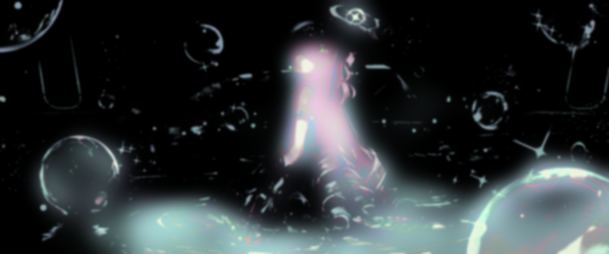

**Language / 语言**：**English** (current) · [简体中文](README.md)

# hdr-gainmap

Turn 8-bit SDR illustrations into HDR masters: one command produces Ultra HDR JPEG, 16-bit PNG, 10/12-bit HEIC, 12-bit AVIF and 24-bit JPEG XL. There are no presets — gain is derived from each image's light field, separately for R, G and B.

## Examples

Source `1777789210281_x4_animejanai.png` (originally 12960×5420, 8-bit SDR; shown here downscaled to 1600×669 for the page, and the measurements below use that downscale):


Top: SDR source; bottom: an approximate SDR-screen preview of the HDR master (`gainmap.render_preview`). Each row keeps the full width instead of squeezing two panels side by side. The preview shows *where* the lift happens, not real luminance on an HDR display:


HDR preview on its own:


The embedded gain map written by `--debug` (full-resolution RGB; whiter = more lift). Water ripples, hair and bubble highlights gain; the night sky and shadows stay near zero:



Decoding: `gain = 2 ** (pixel / 255 * GainMapMax)` per channel, `HDR linear = SDR linear × gain`. With a three-channel map each channel carries its own maximum.

## How it works: one light field, six containers

SDR pixels are linearised with the sRGB EOTF into `L_sdr`, then each channel gets its own gain:

```text
L_hdr,c = g_c · L_sdr,c
g_c     = 2 ** (gmax · em · w_c · tint_c)
```

`em ∈ [0,1)` is normalised emission, `gmax` comes from the image's own exposure percentiles, `w_c` is the light-colour weight and `tint_c` corrects surface tint. The result is converted to BT.2020 and PQ-encoded in cd/m².

All six outputs share the same `em` and the same set of `gmax_c`; only the container, bit depth and chroma sampling differ.

* **PQ is absolute luminance**: `L_hdr` is scaled against SDR white = 203 nits ([BT.2408-9](https://www.itu.int/dms_pub/itu-r/opb/rep/R-REP-BT.2408-9-2026-PDF-E.pdf), [EBU R 167](https://qc.ebu.io/apps/r167/)). 203 nits sits near 0.58 of the PQ signal, so a PQ file dropped into an SDR viewer looks grey — that is a missing HDR pipeline, not a broken file.
* **Ultra HDR stores no second HDR image**: 8-bit SDR base + 8-bit RGB gain map. The map is normalised in log2 to `[0, GainMapMax]`; decoders interpolate by display headroom and multiply, channel by channel ([Ultra HDR spec](https://developer.android.com/media/platform/hdr-image-format), [ISO/IEC 21496-1](https://www.iso.org/standard/86775.html)).
* **The other five formats** store HDR samples directly; SDR fallback is the viewer's tone mapping.

## Six outputs

| Format   | Bit depth / codec                                                      | Typical use                            |
| -------- | ---------------------------------------------------------------------- | -------------------------------------- |
| `jpeg`   | 8-bit sRGB base + 8-bit RGB gain map, MPF + XMP `hdrgm` + 141-byte ISO | Ultra HDR, suffix `.jpeg`              |
| `png`    | 16-bit RGB + PQ (`cICP 9/16/0/1`) + `mDCV` + `cLLI`                    | lossless master, post-production       |
| `heic10` | 10-bit HEVC Main10 (`nclx 9/16/9`)                                     | widest support (Win/macOS/iOS/Android) |
| `heic12` | 12-bit HEVC Main12 (`nclx 9/16/9`)                                     | highest depth, needs decoder support   |
| `avif`   | 12-bit AV1 4:4:4 (`nclx 9/16/9`, auto-fallback)                        | small files, web / sharing             |
| `jxl`    | 24-bit JPEG XL, PQ + BT.2020 (`--override_bitdepth=24`)                | deep lossless master, needs cjxl       |

Container bytes, metadata placement and compatibility traps are covered in documents 05–09 under [docs/](docs/README.md).

## What problem it solves

Inverse tone mapping (ITM) models trained on photographs misbehave on anime flat shading: blotchy gain inside flat fills, entire line art glowing, clipped whites staying white. SDR illustrations have **already clipped** their highlights — there is no hidden detail to "recover".

So the goal is not recovery but classification: is this pixel emitting light? Only emitters are lifted on an HDR display:

* **emitters** (lamps, sparkles, eye highlights, backlit hair) get real gain;
* **lit surfaces** get a little;
* **white hair, white walls, skin** — large, already-bright areas — are left alone as much as possible.

## Algorithm: build the light field, then judge emission

Everything lives in `hdrgainmap/light.py` and `hdrgainmap/gainmap.py`. The field is computed once and reused by every test.

### 1. Light-field analysis

Computed at 640 px on the long edge, then bilinearly upsampled:

```python
src  = clip((Y - p97) / (max - p97), 0, 1) ** 1.4    # source pixels
tau  = 0.45 + 0.55 * Y                             # brighter travels further
F    = S + 0.88 * shift(F, dir) * tau               # 40 steps × 8 directions
diff = Σ w_k · gauss(src, σ_k),  σ_k = base·2^k,  w_k = σ_k^-1.75
field = 0.68*diff + 0.32*beams
field = field * (0.25 + 0.75*Y) * atten + 0.06*(1-atten)*p90
```

* **Sources**: pixels above the 97th percentile; exponent 1.4 keeps only clear highlights near 1.
* **Beams**: 40 steps along 8 directions, spreading and decaying luminance. This is a propagation integral over the brightness field, not a geometric ray.
* **Diffuse**: four Gaussians, weights `σ^-1.75` — Gaussian core, `1/r^p` tail.
* **Absorption and airlight**: `atten = exp(-1.1·depth)`, plus 6% airlight at distance — the algorithmic form of aerial perspective (see [docs/11](docs/11-perspective.md)).
* **AO**: `clip((near+0.02)/(far+0.02), 0.45, 1.0)^0.9`, with a guided filter on the small radius to keep edges.
* **Light colour**: mean linear RGB of source pixels, normalised by luminance, feeding the per-channel path.

### 2. Adaptive parameters

```python
t        = clip(p50 / 0.60, 0, 1)                        # 0=night, 1=high-key
cover    = clip(source_pct / 12, 0, 1)                   # source coverage
gmax     = min((2.2 - 0.6*t) * 0.70 * (1 - 0.10*cover), 1.45)
halo     = 0.16 - 0.06*t
hr       = max(1, round(3 - 2*t))
base_lit = 0.78 - 0.16*t
```

`cover` is new: the more of the frame is already emitting, the less global lift is needed, so `gmax` tapers. `PEAK_SCALE = 0.70` and `GMAX_CAP = 1.45` remain hard limits — past roughly 1.6 EV some phones clip highlights to black.

### 3. Emission tests

```python
illum = guided_filter(Y, gauss(Y, min(h, w)//25), r//2)   # edge-preserving low band
lit   = smoothstep(p38(illum), p99(illum), illum)          # lit regions
peak  = Y / (gauss(Y, 25) + 1e-3)
spark = smoothstep(1.45, 2.90, peak)                       # point highlights
area  = gauss(lit, min(h, w)//8)
pen   = 0.55 * smoothstep(0.35, 0.85, area) * (1 - 0.7*spark)
lit  *= 1 - pen                                            # large flat bright areas
white = smoothstep(0.92, 1.0, Y) * (1 - pen)

emis = base_lit*lit + 0.45*irradiance + 0.45*spark + 0.18*white + 0.10*amb
emis = halo * gauss(emis, hr) + (1 - halo) * emis
```

`illum` is now guided by `Y` itself instead of a plain Gaussian: lit regions still rise as a whole, but object edges are not smeared. `irradiance` and `amb` come from the field's irradiance and AO.

### 4. Per-channel exposure

```python
lum   = max(0.2126R + 0.7152G + 0.0722B, 1e-4)
tint  = clip((L_c / lum) ** 0.35, 0.85, 1.15)             # surface tint
w_c   = tint * clip(clip(light_color, 0.25, 4) ** 0.6, 0.80, 1.25)
w_c  /= BT.709 luminance(w_c)                              # keep total luminance
expo  = gmax * emis * w_c
```

`w_c` gives the blue channel more headroom under warm light; `tint` corrects single-channel bias on saturated surfaces. Both are clamped so pure colours do not turn neon. The weighted luminance is normalised, so overall lift is still governed by `gmax·emis`.

### 5. Soft saturation and quantisation

```python
em   = 1 - exp(-emis / p99.9(emis) * 1.6)
em   = gauss(em, 2)
```

Hard clamping creates a plateau at 1.0 whose border is a visible contour ring. Exponential saturation is smooth everywhere and only approaches 1.

The gain map is written in two passes: per-tile `expo_max` per channel, then `code = expo / expo_max * 255 + triangular dither`. Dither is applied before quantisation, breaking up Mach bands in large gradients.

## Install

```bash
pip install -e .
# or
pip install -r requirements.txt
```

Requires `numpy`, `pillow`, `pillow-heif`; GPU acceleration needs `wgpu` (`pip install -e .[gpu]`) and otherwise falls back to the CPU; AVIF needs `ffmpeg` with libaom-av1. 24-bit JXL needs `cjxl` 0.13+ (libjxl) on `PATH`, or `HDRGAINMAP_CJXL` / `HDRGAINMAP_JXLINFO`. Missing cjxl fails only the `jxl` entry. Python 3.10+.

## Usage

### Common commands

```bash
# default: all six formats, quality 100, DPI from the source
python -m hdrgainmap photo.png -o out

# only 24-bit JXL
python -m hdrgainmap photo.png -o out -f jxl

# batch
python -m hdrgainmap a.png b.jpg c.webp -o out --quiet

# lossless master plus the most compatible HEIC
python -m hdrgainmap photo.png -o out -f png,heic10

# quality 90 for lossy formats, with validation
python -m hdrgainmap photo.png -o out -q 90 --validate

# flatten transparency onto white
python -m hdrgainmap logo.png -o out --alpha-bg white

# machine-readable output
python -m hdrgainmap photo.png -o out --json --validate
```

### Output names

With input stem `{stem}`:

| Output            | File name                                                              |
| ----------------- | ---------------------------------------------------------------------- |
| Ultra HDR JPEG    | `{stem}_ultrahdr.jpeg`                                                 |
| 16-bit PNG        | `{stem}_hdr16_pq.png`                                                  |
| 10-bit HEIC       | `{stem}_hdr10_pq.heic`                                                 |
| 12-bit HEIC       | `{stem}_hdr12_pq.heic`                                                 |
| 12-bit AVIF       | `{stem}_hdr12_pq.avif`                                                 |
| 24-bit JXL        | `{stem}_hdr24_pq.jxl`                                                  |
| debug (`--debug`) | `{stem}_emis.png`, `{stem}_gainmap.png`, `{stem}_gainmap_embedded.png` |

### Exit codes and batching

* `0`: everything succeeded; with `--validate` the checks must also pass;
* `1`: at least one file or format failed, or validation failed; JSON reports `ok=false` and `errors`;
* `2`: bad command line (argparse).

Files are processed in the order given; one failure does not stop the rest. `--quiet` prints errors only. `--json` emits one object for a single input and `{"results": [...], "ok": ...}` for several.

### Options

| Option          | Meaning                                                         |
| --------------- | --------------------------------------------------------------- |
| `-o, --outdir`  | output directory, default `out`                                 |
| `-f, --formats` | comma-separated: `jpeg` `png` `heic10` `heic12` `avif` `jxl`    |
| `-q, --quality` | lossy quality 50–100, default 100                               |
| `--dpi`         | output DPI, default from the source                             |
| `--alpha-bg`    | flatten transparency onto `black` (default) or `white`          |
| `--validate`    | validate every output, exit 1 on failure                        |
| `--debug`       | also write `_emis.png`, `_gainmap.png`, `_gainmap_embedded.png` |
| `--quiet`       | no progress output                                              |
| `--json`        | JSON with paths, stats and validation reports                   |
| `--version`     | print version                                                   |

Scope: `-q` affects JPEG/HEIC/AVIF only (PNG and JXL are always lossless); `--dpi` is written to every output, JXL included (container `Exif` box); `--alpha-bg` only matters for sources with alpha. `-j` encodes several formats at once (JXL and AVIF are subprocesses, the PNG filter is parallel by block); `--gpu off` forces the CPU path for both the field blurs and the per-pixel math; `--transfer` and `--gain-fullres` were removed: transfer is always PQ and the gain map is always full-resolution.

The three debug images differ: `_emis.png` is the emission field (intermediate weights, not final gain); `_gainmap.png` is a log2-normalised view of the scalar gain; `_gainmap_embedded.png` is the RGB map actually embedded in the JPEG (with dither).

## Python API

```python
from hdrgainmap import build

res = build(
    "photo.png",
    "out",
    formats=("jpeg", "png", "heic12", "jxl"),
    quality=100,
    alpha_bg=(0, 0, 0),
    log=print,
)
print(res["files"]["heic12"])
print(res["stats"]["peak_nits"], res["stats"]["gmax_channels"])
```

`build()` returns (values vary by image):

```python
{
  "src": "photo.png", "dpi": 240.0, "gmax": 1.45,
  "gmax_meta": 1.374893, "gmax_channels": [1.201138, 1.214826, 1.374893],
  "files": {"jpeg": "...", "png": "...", "heic12": "..."},
  "errors": {},
  "stats": {"gain_mean": 1.212, "gain_max": 2.230, "untouched_pct": 48.7,
            "gt2x_pct": 1.7, "peak_nits": 486.0, "base_reused": True},
  "timings": {"load": 0.02, "gain": 1.23, "hdr": 0.25, "jxl": 0.79,
              "jpeg": 0.45, "png": 0.76, "heic10": 0.99, "heic12": 0.97,
              "avif": 2.36, "total": 4.37},
  "ok": True,
}
```

Key fields:

* `gmax`: scalar maximum gain (stats and debug); `gmax_channels`: per-channel maxima; `gmax_meta`: the single-channel fallback written to XMP;
* `files`: successful paths; `errors`: per-format exceptions, other formats continue;
* `stats.gain_mean / gain_max`: scalar gain mean/peak;
* `stats.untouched_pct`: share of pixels with `gain < 1.02`;
* `stats.gt2x_pct`: share above 2×;
* `stats.peak_nits`: absolute peak luminance of the HDR linear image;
* `stats.base_reused`: whether the source JPEG was reused as the SDR base;
* `timings`: seconds per stage, `total` overall; `ok`: no format failed.

Individual modules:

```python
from hdrgainmap import gainmap, light, color, png16, heic10, avif

rgb, im, meta = gainmap.prepare_image("photo.png")   # orientation/alpha/ICC normalised
y = gainmap.luma(rgb)
scene = light.analyze(rgb, y)                        # sources/beams/irradiance/AO/depth
cfg = gainmap.adapt_params(rgb, y=y, scene=scene)
_, emis = gainmap.emissive(rgb, cfg, y=y, scene=scene)
weights = gainmap.channel_weights(rgb, y=y, scene=scene)
gain = gainmap.gain_of(gainmap.finalize(emis), cfg["gmax"])
```

For 16-bit PQ codes, use the pipeline's per-channel, tiled path:

```python
from hdrgainmap.pipeline import _hdr_code

q16 = _hdr_code(rgb, gainmap.finalize(emis), cfg["gmax"], weights, tile_rows=2048)
```

24-bit JXL skips `q16`: write a PFM of float32 codes, then hand it to cjxl:

```python
from pathlib import Path
from hdrgainmap import jxl, pipeline

pfm = Path("tmp.pfm")
pipeline._write_pfm(rgb, gainmap.finalize(emis), cfg["gmax"], weights, pfm)
jxl.encode(pfm, "out.jxl")      # --override_bitdepth=24 -d 0
pfm.unlink()
```

## Colour and containers

* **Source pixels are interpreted as sRGB**; embedded ICC profiles are converted to sRGB (Display-P3, Adobe RGB, CMYK, LAB), falling back to the original on failure. EXIF orientation is applied first; alpha is flattened per `--alpha-bg`.
* Gain is applied **per channel** in linear light, then converted to **BT.2020** and encoded with **PQ** (SDR white = 203 nits). One path for all formats.
* **PNG** writes `cICP = (9, 16, 0, 1)` (BT.2020 / PQ / RGB matrix / full range), plus `mDCV` (BT.2020, D65, 1000/0.005 nits) and `cLLI` (MaxCLL = MaxFALL = actual peak). `matrix=0` is correct for RGB.
* **HEIC** writes `nclx = (9, 16, 9)`; **matrix must be 9** (BT.2020 NCL). Left at 6 (BT.601), some decoders apply the wrong inverse matrix and colours shift.
* **AVIF**'s ffmpeg muxer writes no colour tags (2/2), so the seven `nclx` bytes are patched after encoding; DPI is added as an Exif item. 12-bit 4:4:4 falls back to 12/420 → 10/444 → 10/420.
* **JXL** is fixed at 24-bit, PQ, BT.2020 (`Rec2100PQ`). cjxl does not read PNG's PQ tag, so codes travel as float32 in a PFM and are encoded with `--override_bitdepth=24 -d 0`, avoiding fake depth from a 16-bit left shift. DPI rides in the container `Exif` box (`-x exif=`, TIFF without the `Exif\0\0` prefix) with `--compress_boxes` off so it stays readable.
* **DPI**: PNG uses `pHYs`; HEIC borrows EXIF 282/283/296; AVIF adds an Exif item.

### Ultra HDR: one JPEG, two pictures

Ultra HDR is not HDR samples stuffed into JPEG. It is **an SDR base image plus an 8-bit gain map**, tied together by **MPF** (CIPA DC-007). The base is a complete SDR image; the map stores each pixel's log2 ratio, and decoders interpolate it by display headroom before multiplying.

The output is Ultra HDR 1.1: XMP `hdrgm` and ISO 21496-1 are written together, and 1.1 is backward compatible with 1.0.

Gain-map conventions:

* 8-bit **RGB** JPEG, `q=100`, `optimize`, `subsampling=0`;
* **full resolution** `w × h`;
* value = `expo_c / expo_max,c` scaled to 8 bits, with ±1 LSB triangular dither applied before quantisation;
* `GainMapMin = 0`, `GainMapMax = max(gmax_channels)` (XMP fallback), `Gamma = 1`, `OffsetSDR = OffsetHDR = 1/64`, `BaseRenditionIsHDR = False`.

#### Container and metadata

Both pictures are complete JPEGs. The primary is ordered **ICC → EXIF → ISO stub → MPF → XMP**; the gain map carries **XMP → ISO (141 bytes)**. The MPF TIFF directory has two entries: primary attribute `0x00030000`, gain-map attribute `0`, with the gain-map offset relative to the MPF TIFF header.

`hdrgm` uses **element** form, never attribute form: attribute form makes highlights go black on some Honor / Android 16 devices.

#### Two metadata sets: XMP and ISO 21496-1

* **XMP `hdrgm`**: the original Ultra HDR carrier, decimal fixed point with eight decimals. It has only a single-channel `GainMapMax` and serves as the legacy fallback.
* **ISO 21496-1 APP2**: a 4-byte version stub in the primary, and the full **141-byte** three-channel payload in the gain map — `flags = 0xC0` (bit 7 three channels, bit 6 use base colour space), base/alternate headroom, then five rationals per channel (min / max / gamma / base offset / alternate offset). Big-endian, denominator `1e8`.
* Both are always written and must agree; `validate` cross-checks them.

> ISO requires big-endian: `0.89387586` read little-endian becomes about `75`, which turns highlights black. The writer emits big-endian and the validator checks it byte by byte.

#### Decoding

```text
log2_gain_c = GainMapMax_c * (pixel_c / 255)
HDR_c       = (SDR_c + OffsetSDR) * 2 ** log2_gain_c - OffsetHDR
```

`pixel_c` is channel c of the gain map. Headroom-aware decoders first interpolate `log2_gain` between `[HDRCapacityMin, HDRCapacityMax]` from `log2(max_display_boost)`, so the same file looks different on a 400-nit and a 1000-nit panel.

## Quality and performance

Quality-first defaults:

* JPEG quality 100, 4:4:4, including the gain map at full resolution;
* HEIC / AVIF quality 100 (AVIF `crf = (100-q)*0.63`, so 100 → crf 0);
* AVIF prefers 4:4:4 — 4:2:0 smears coloured highlights on line art;
* PNG lossless, zlib level 9, with `mDCV`/`cLLI`;
* JXL 24-bit lossless (`-d 0 -e 7 --override_bitdepth=24`).

Measured (6-core CPU):

* **1600×669 example**: 4.5 s end to end (4-way parallel + GPU; 4.8 s on CPU — about level at this size), gain 1.8 s and PQ encoding 0.02 s; Ultra HDR 0.87 MB, PNG 3.92 MB, HEIC 0.36 MB, AVIF 1.73 MB, JXL 5.62 MB; peak 486 nits; per-channel gmax 1.20 / 1.21 / 1.38;
* **Reconstruction**: gains decoded from the Ultra HDR JPEG versus the PNG master show 1.3% mean relative error, 4.2% p95, peak 489 vs 486 nits;
* **earlier 70 MP measurements** (order of magnitude only): 17.8 MP Ultra HDR alone ≈ 45 s; 70.2 MP five formats ≈ 7.5 min (gain 181 s, PNG 111 s, AVIF 89 s, HEIC 18 s); 70.2 MP JXL ≈ 232 s / 273 MB with an ≈ 840 MB temporary PFM.

HDR intermediates are encoded in `tile_rows=2048` bands so a full float32 frame never has to be resident; every output is written atomically (temp file + `os.replace`). At hundreds of megapixels PNG reaches hundreds of MB — plan memory accordingly.

## Validation

```bash
python -m hdrgainmap.validate out/x_hdr16_pq.png out/x_hdr10_pq.heic out/x_hdr12_pq.heic out/x_hdr12_pq.avif out/x_hdr24_pq.jxl
```

* **PNG**: IHDR 16-bit RGB, `cICP` 9/16, `mDCV` 24 bytes, `cLLI` 8 bytes, pHYs, zlib length and filter bytes, decodability;
* **HEIC**: 10/12-bit, `nclx` primaries=9, transfer 16, **matrix=9**, code-value clipping;
* **AVIF**: major brand, `nclx`, `pixi` depth, decodability;
* **Ultra HDR**: two MPF entries, `hdrgm`, decodable gain map; ISO field-by-field (stub, 141-byte payload, agreement with XMP);
* **JXL**: signature, `jxlinfo` reports 24-bit, transfer PQ, primaries Rec.2100; without jxlinfo it degrades to a signature check with a warning.

## Tests

```bash
python -m pytest              # 21 passed, 1 skipped without cjxl
python tests/test_roundtrip.py  # standalone script also works
```

Coverage: PQ round-trip, adaptive parameters, all six formats, 24-bit JXL depth/colour, both PNG decode paths, `cICP`/`mDCV`/`cLLI`, quality affecting size, EXIF orientation, alpha flattening, ICC→sRGB, tiled HDR consistency, luminance conservation of per-channel weights, flat-area penalty, atomic writes, JPEG base reuse, API validation, RGB full-resolution debug map, ISO three-channel layout, and Ultra HDR reconstruction versus PNG.

## Known limitations

* **12-bit HEIC is niche**: the Windows HEVC extension only ships Main10; Main12 fails with `0xC00D3E8C` and needs a third-party decoder.
* **12-bit AVIF**: Chromium and Firefox software-decode it; Windows Photos needs the AV1 extension.
* **PQ in an SDR pipeline looks grey** by construction: SDR white (203 nits) is only \~0.58 of the signal.
* **HEIF has no DPI field**: DPI lives in EXIF; WIC honours it, some third-party apps do not.
* **HEIC/AVIF SDR fallback is viewer-dependent**: there is only one HDR image, no separate SDR base; some Android 16 devices raise PQ codes globally, making the SDR view look overexposed while HDR is fine.
* **XMP-only decoders lose per-channel gain**: XMP stores a single maximum; the per-channel split exists only in the ISO payload.
* **Heuristic limits**: very large flat bright areas can be suppressed too much; noise in very dark images can be mistaken for sparkles; the light field's "depth" is a proxy, not a real Z.
* **AVIF output is plain HDR AVIF**, not a gain-map tmap container; SDR fallback is the viewer's job.
* **24-bit JXL support is thin**: recent Chrome/Firefox decode it; Windows Photos and Explorer may not; DPI lives in the container `Exif` box, so only Exif-aware tools show it.
* **GPU covers per-pixel math and full-resolution blurs**: PQ encoding, gain coefficients and the box/guided filters inside `emissive` all run on the GPU (at 6.2 MP, gain 7.8 s → 1.8 s and PQ 4.0 s → 0.12 s), with 8-bit gain maps byte-identical and 16-bit codes differing by at most 1 LSB; `light.analyze` (multi-scale blurs plus ray marching on a 640 px long edge) stays on the CPU. 6.2 MP end to end drops from 38.0 s to 23.5 s, at which point 12-bit 4:4:4 AVIF (\~20 s) dominates.

## Technical documentation

Standards, theory and container byte layouts live under [docs/](docs/README.md), twelve documents:

| #  | Document                                                        | Contents                                                      |
| -- | --------------------------------------------------------------- | ------------------------------------------------------------- |
| 01 | [HDR vs SDR: definitions and standards](docs/01-hdr-and-sdr.md) | three meanings of dynamic range, standards, 203 nits          |
| 02 | [PQ and luminance](docs/02-pq-and-brightness.md)                | ST 2084, code-value tables, bit depth                         |
| 03 | [Gamut, depth and colour](docs/03-color-gamut-and-depth.md)     | BT.2020, matrices, dither, ICC vs CICP                        |
| 04 | [How gain maps work](docs/04-gain-map.md)                       | ratios, log2, headroom, per-channel, ISO                      |
| 05 | [JPEG and Ultra HDR](docs/05-jpeg-ultra-hdr.md)                 | MPF, XMP, ISO 21496-1, compatibility                          |
| 06 | [PNG](docs/06-png.md)                                           | chunks, filters, cICP/mDCV/cLLI, 16-bit                       |
| 07 | [HEIC](docs/07-heic.md)                                         | HEIF boxes, HEVC Main10/12, nclx                              |
| 08 | [AVIF](docs/08-avif.md)                                         | AV1, 12-bit 4:4:4, byte patching                              |
| 09 | [JPEG XL](docs/09-jpeg-xl.md)                                   | 24-bit, PFM, cjxl                                             |
| 10 | [Light and rendering](docs/10-light-and-rendering.md)           | propagation, reflection, ray tracing, GI, AO, the light field |
| 11 | [Spatial perspective](docs/11-perspective.md)                   | linear/aerial perspective, depth cues                         |
| 12 | [Glossary](docs/12-glossary.md)                                 | bilingual terms, symbols, units                               |

Citations sit where they are used (`[[n]](#rn)` → sources at the end of each document); there is no separate bibliography page. Version history lives in [CHANGELOG.md](CHANGELOG.md).

## Layout

```
hdr-gainmap/
├─ hdrgainmap/
│  ├─ color.py      colour spaces and transfer functions (sRGB / PQ / BT.2020)
│  ├─ gainmap.py    input normalisation, emission weights, per-channel weights
│  ├─ light.py      light-field analysis (sources, beams, irradiance, AO, depth)
│  ├─ png16.py      16-bit PQ PNG codec (cICP / mDCV / cLLI)
│  ├─ heic10.py     10/12-bit HEIC codec (nclx 9/16/9)
│  ├─ avif.py       12-bit AVIF codec (ffmpeg/libaom, nclx and Exif DPI patching)
│  ├─ jxl.py        24-bit JPEG XL (PFM → cjxl)
│  ├─ ultrahdr.py   Ultra HDR mux/parse (MPF + XMP + three-channel ISO)
│  ├─ validate.py   output validation
│  ├─ pipeline.py   end-to-end build
│  └─ cli.py        command line
├─ tests/
│  ├─ test_roundtrip.py
│  └─ test_units.py
├─ docs/            technical documentation 01–12 (Chinese) + images/ example images
├─ CHANGELOG.md     version history
├─ pyproject.toml
├─ LICENSE          MIT
└─ _archive/        historical snapshots and experiments
```

## Licence and third parties

This project is released under the MIT License; see [LICENSE](LICENSE). There is no separate notices file — the complete list follows.

**Runtime dependencies**

| Component   | Licence      | Notes                                                                                        |
| ----------- | ------------ | -------------------------------------------------------------------------------------------- |
| NumPy       | BSD-3-Clause | arrays and filtering                                                                         |
| Pillow      | MIT-CMU      | image I/O, ICC conversion                                                                    |
| pillow-heif | BSD-3-Clause | HEIF/HEIC; the wheel bundles libheif LGPL-3.0, x265 GPL-2.0/commercial and libde265 LGPL-3.0 |

**External tools** (not bundled; invoked via `subprocess` at runtime)

| Tool          | Licence                            | Use                     |
| ------------- | ---------------------------------- | ----------------------- |
| FFmpeg        | GPL build locally (GPL components) | AVIF muxing, PNG decode |
| libaom        | BSD-style                          | AV1 encoding            |
| SVT-AV1       | BSD-3-Clause Clear                 | AV1 fallback            |
| x264 / x265   | GPL-2.0                            | indirectly via libheif  |
| libjxl / cjxl | BSD-3-Clause                       | JPEG XL encoding        |

The project itself stays MIT. Redistributing a GPL build of ffmpeg or an x265-bearing wheel requires GPLv3/LGPL-3.0 licence texts and corresponding sources. No extra licence purchase is needed for the current usage; an x265 commercial licence only matters for closed-source distribution that cannot accept the GPL. The repository contains no third-party images; the examples were generated from a user-provided source, so confirm your rights before redistributing them.

**Language / 语言**：**English** (current) · [简体中文](README.md)
