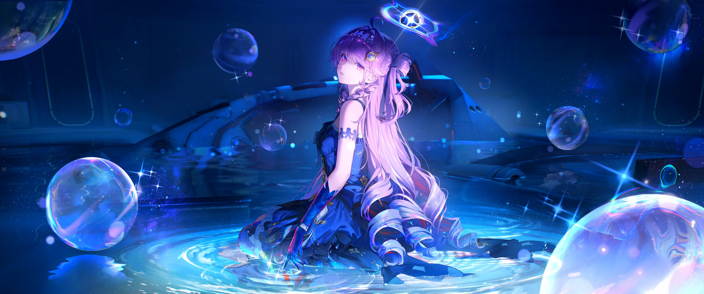
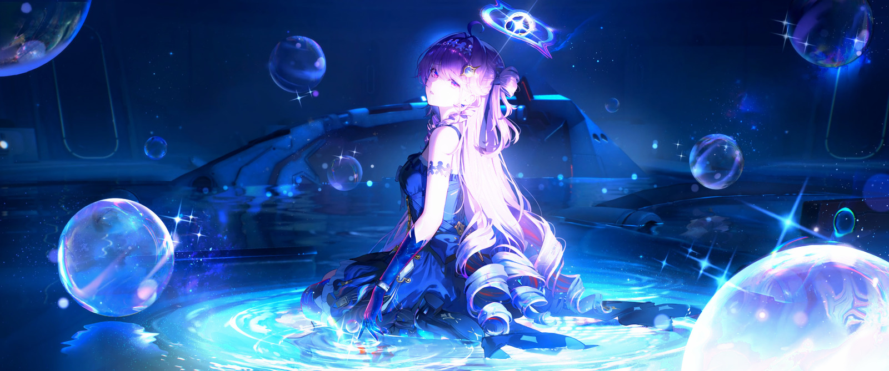
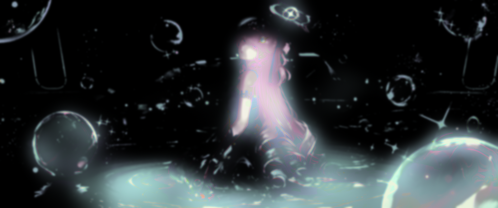

**语言 / Language**：[简体中文](README.md)（当前） · [English](README.en.md)

# hdr-gainmap

把 8bit SDR 插画转成 HDR 母版：一条命令输出 Ultra HDR JPEG、16bit PNG、10/12bit HEIC、12bit AVIF 与 24bit JPEG XL。不设档位，增益按每张图自己的光场计算——而且是 R/G/B 各算一份。

## 示例

示例源图 `1777789210281_x4_animejanai.png`（原始 12960×5420，8bit SDR；本文缩到 1600×669 以便浏览，实测数据也基于这张缩放图）：



上：SDR 源图；下：生成的 HDR 母版在 SDR 屏幕上的近似预览（`gainmap.render_preview`）。上下各占满整宽，不再左右对半压缩。预览只说明“哪里被抬亮”，不代表 HDR 屏上的真实亮度：


HDR 预览单独放大：



`--debug` 输出的内嵌增益图（全分辨率 RGB，越白抬得越多）。水面涟漪、发丝与气泡高光拿增益，夜空与暗部接近 0：



解码公式：`gain = 2 ** (pixel / 255 * GainMapMax)`，`HDR 线性光 = SDR 线性光 × gain`。三通道时每个通道有自己的 `GainMapMax`。

## 原理：一条光场，六种封装

SDR 像素按 sRGB EOTF 还原成线性光 `L_sdr`，每个通道乘各自的增益 `g_c`：

```text
L_hdr,c = g_c · L_sdr,c
g_c     = 2 ** (gmax · em · w_c · tint_c)
```

`em ∈ [0,1)` 是归一化发光度，`gmax` 由图像自身的曝光分位数决定，`w_c` 是光色权重，`tint_c` 是表面色偏修正。再转 BT.2020、按 PQ 编码成 cd/m²。

六种产物共用同一个 `em` 与同一组 `gmax_c`，区别只在容器、色深与色度抽样，所以“哪里亮”在六种格式里一致。

* **PQ 是绝对亮度**：`L_hdr` 以 SDR 白 = 203 nits 为基准换算成 cd/m² 再编码（[BT.2408-9](https://www.itu.int/dms_pub/itu-r/opb/rep/R-REP-BT.2408-9-2026-PDF-E.pdf)、[EBU R 167](https://qc.ebu.io/apps/r167/)）。203 nits 在 PQ 码值上约 0.58，把 PQ 文件直接塞进 SDR 查看器会发灰——不是文件坏了，是缺少 HDR 渲染链路。
* **Ultra HDR 不存第二张 HDR 图**：8bit SDR 主图 + 8bit RGB 增益图。增益图在 log2 域归一化到 `[0, GainMapMax]`，解码端按显示器 headroom 插值后乘回 SDR，并按通道各乘各的（[Ultra HDR 规范](https://developer.android.com/media/platform/hdr-image-format)、[ISO/IEC 21496-1](https://www.iso.org/standard/86775.html)）。
* **其余五种格式**没有增益图：它们直接存 HDR 样本，SDR 回退交给查看器 tone mapping。

## 六种产物

| 格式       | 色深 / 编码                                                      | 典型用途                              |
| -------- | ------------------------------------------------------------ | --------------------------------- |
| `jpeg`   | 8bit sRGB 主图 + 8bit RGB 增益图，MPF + XMP `hdrgm` + ISO 三通道 141B | Ultra HDR，后缀 `.jpeg`              |
| `png`    | 16bit RGB + PQ（`cICP 9/16/0/1`）+ `mDCV` + `cLLI`             | 无损母版、后期交换                         |
| `heic10` | 10bit HEVC Main10（`nclx 9/16/9`）                             | 兼容性最好（Windows / macOS / iOS / 安卓） |
| `heic12` | 12bit HEVC Main12（`nclx 9/16/9`）                             | 色深最高，需解码端支持                       |
| `avif`   | 12bit AV1 4:4:4（`nclx 9/16/9`，失败自动降级）                        | 体积小，网页 / 分享                       |
| `jxl`    | 24bit JPEG XL，PQ + BT.2020（`--override_bitdepth=24`）         | 高位深无损母版，需 cjxl                    |

格式细节（容器字节、元数据位置、兼容性坑）见 [docs/](docs/README.md) 的第 05–09 篇。

## 它解决什么问题

照片训练的 ITM（inverse tone mapping）模型在二次元平涂上容易翻车：平涂糊出块状增益、线稿整条发光、纯白死白。而 SDR 插画的高光**本来就已经削顶**，并没有暗藏细节可“恢复”。

所以目标不是恢复高光细节，而是判断“这块像素是不是在发光”，只把发光体在 HDR 屏上抬亮：

* **发光体**（灯、星芒、眼神光、高光发丝）拿到明显增益；
* **被光照到的表面**拿到少量增益；
* **白发、白墙、皮肤**这类“本来就亮”的大面积区域尽量不动。

## 算法：先建光场，再判发光

整条链路在 `hdrgainmap/light.py` 与 `hdrgainmap/gainmap.py`。光场只算一次，后面所有判据都复用它。

### 1. 光场分析

在 640 长边的降采样图上做，最后双线性升回原尺寸：

```python
src  = clip((Y - p97) / (max - p97), 0, 1) ** 1.4    # 光源像素
tau  = 0.45 + 0.55 * Y                             # 亮处传播更远
F    = S + 0.88 * shift(F, dir) * tau               # 40 步 × 8 方向
diff = Σ w_k · gauss(src, σ_k),  σ_k = base·2^k,  w_k = σ_k^-1.75
field = 0.68*diff + 0.32*beams                      # 漫反射 + 光束
field = field * (0.25 + 0.75*Y) * atten + 0.06*(1-atten)*p90
```

* **光源**：亮度高于第 97 百分位的像素，指数 1.4 让只有明显高光才接近 1。
* **光束**：沿 8 个方向步进 40 次，把亮度逐步扩散并衰减。这是亮度场上的传播积分，不是几何光线。
* **漫反射**：4 个尺度的高斯，权重 `σ^-1.75`，核心近似高斯、尾部近似 `1/r^p`。
* **衰减与大气光**：`atten = exp(-1.1·depth)`，远处叠 6% 的大气光，等效“黑位抬高、对比度下降”（空气透视，见 [docs/11](docs/11-perspective.md)）。
* **AO**：`clip((near+0.02)/(far+0.02), 0.45, 1.0)^0.9`，小半径用导向滤波保住边界。
* **光色**：光源像素的线性 RGB 均值，按亮度归一，供分通道使用。

### 2. 自适应参数

```python
t        = clip(p50 / 0.60, 0, 1)                        # 0=夜景，1=高调
cover    = clip(source_pct / 12, 0, 1)                   # 光源覆盖率
gmax     = min((2.2 - 0.6*t) * 0.70 * (1 - 0.10*cover), 1.45)
halo     = 0.16 - 0.06*t                                 # 泛光占比
hr       = max(1, round(3 - 2*t))                        # 泛光半径
base_lit = 0.78 - 0.16*t                                 # 受光基础权重
```

`cover` 是新增项：光源占画面越多，整张图越不需要再抬，`gmax` 自动收敛。`PEAK_SCALE = 0.70` 与 `GMAX_CAP = 1.45` 仍是硬约束——超过约 1.6 EV 时部分手机的高光会出现黑斑。

### 3. 发光判据

```python
illum = guided_filter(Y, gauss(Y, min(h, w)//25), r//2)   # 保边的低频光照
lit   = smoothstep(p38(illum), p99(illum), illum)          # 被照到的整片
peak  = Y / (gauss(Y, 25) + 1e-4)
spark = smoothstep(1.45, 2.90, peak)                       # 点状高光
area  = gauss(lit, min(h, w)//8)
pen   = 0.55 * smoothstep(0.35, 0.85, area) * (1 - 0.7*spark)
lit  *= 1 - pen                                            # 大片白墙/天空降权
white = smoothstep(0.92, 1.0, Y) * (1 - pen)

emis = base_lit*lit + 0.45*irradiance + 0.45*spark + 0.18*white + 0.10*amb
emis = halo * gauss(emis, hr) + (1 - halo) * emis
```

`illum` 从纯高斯换成导向滤波（以 `Y` 自身为导向），灯光照到的整片会抬起，但物体边界不会被抹平。`irradiance` 与 `amb` 分别来自光场的辐照度与 AO。

### 4. 分通道曝光

```python
lum   = max(0.2126R + 0.7152G + 0.0722B, 1e-4)
tint  = clip((L_c / lum) ** 0.35, 0.85, 1.15)             # 表面色偏
w_c   = tint * clip(clip(light_color, 0.25, 4) ** 0.6, 0.80, 1.25)
w_c  /= BT.709 亮度(w_c)                                  # 保持总亮度不变
expo  = gmax * emis * w_c
```

`w_c` 让暖光下的蓝通道多拿一点 headroom，`tint` 修正饱和色表面的单通道偏差；两者都做了限幅，避免把纯色物体推成霓虹。加权亮度被归一化，所以“整体亮多少”仍由 `gmax·emis` 决定。

### 5. 饱和与量化

```python
em   = 1 - exp(-emis / p99.9(emis) * 1.6)   # 指数饱和，不硬截断
em   = gauss(em, 2)
```

硬截断会在亮部造出“顶到 1.0 的平台”，平台边界就是肉眼可见的等值线光圈。指数饱和处处连续可导。

增益图取两遍：第一遍按 tile 求每个通道的 `expo_max`，第二遍 `code = expo / expo_max * 255 + 三角抖动`。抖动在量化前加，打散大面积渐变上的马赫带。

## 安装

```bash
pip install -e .
# 或者
pip install -r requirements.txt
```

依赖 `numpy`、`pillow`、`pillow-heif`；GPU 加速需要 `wgpu`（`pip install -e .[gpu]`），没有就自动走 CPU；AVIF 需要系统里有 `ffmpeg`（带 libaom-av1）。24bit JXL 需要 `cjxl` 0.13+（libjxl），可放进 `PATH`，或用 `HDRGAINMAP_CJXL` / `HDRGAINMAP_JXLINFO` 指定路径；缺少 cjxl 时只让 jxl 这一项失败。Python 3.10+。

## 用法

### 常用命令

```bash
# 默认：六种格式全出，质量 100，DPI 沿用源图
python -m hdrgainmap photo.png -o out

# 只要 24bit JXL
python -m hdrgainmap photo.png -o out -f jxl

# 批量处理
python -m hdrgainmap a.png b.jpg c.webp -o out --quiet

# 只要无损母版和兼容性最好的 HEIC
python -m hdrgainmap photo.png -o out -f png,heic10

# 质量 90（有损格式）并顺带做合规校验
python -m hdrgainmap photo.png -o out -q 90 --validate

# 透明图合成到白底
python -m hdrgainmap logo.png -o out --alpha-bg white

# 机器可读输出
python -m hdrgainmap photo.png -o out --json --validate
```

### 输出命名

设输入文件名为 `{stem}`：

| 产物             | 文件名                                                                  |
| -------------- | -------------------------------------------------------------------- |
| Ultra HDR JPEG | `{stem}_ultrahdr.jpeg`                                               |
| 16bit PNG      | `{stem}_hdr16_pq.png`                                                |
| 10bit HEIC     | `{stem}_hdr10_pq.heic`                                               |
| 12bit HEIC     | `{stem}_hdr12_pq.heic`                                               |
| 12bit AVIF     | `{stem}_hdr12_pq.avif`                                               |
| 24bit JXL      | `{stem}_hdr24_pq.jxl`                                                |
| 调试图（`--debug`） | `{stem}_emis.png`、`{stem}_gainmap.png`、`{stem}_gainmap_embedded.png` |

### 退出码与批处理

* `0`：全部成功；加了 `--validate` 时还要求校验通过；
* `1`：至少一个文件或格式失败，或者校验失败；JSON 里 `ok=false`，`errors` 给出原因；
* `2`：命令行参数错误（argparse）。

批量时按命令行顺序逐张处理，单张失败不影响后续；`--quiet` 只保留错误输出。`--json` 单张时输出结果对象，多张时输出 `{"results": [...], "ok": ...}`。

### 参数

| 参数              | 说明                                                      |
| --------------- | ------------------------------------------------------- |
| `-o, --outdir`  | 输出目录，默认 `out`                                           |
| `-f, --formats` | 逗号分隔：`jpeg` `png` `heic10` `heic12` `avif` `jxl`，默认全部   |
| `-q, --quality` | 有损编码质量 50–100，默认 100                                    |
| `--dpi`         | 输出 DPI，默认沿用源图                                           |
| `--alpha-bg`    | 透明图合成底色 `black`（默认）/ `white`                            |
| `--validate`    | 生成后逐个产物跑合规校验，失败时退出码 1                                   |
| `--debug`       | 额外落盘 `_emis.png`、`_gainmap.png`、`_gainmap_embedded.png` |
| `-j, --jobs`    | 并行编码的格式数，同时作为各编码器线程数，默认 4                               |
| `--gpu`         | `auto`（默认）/ `on` / `off`：PQ 与增益图逐像素数学是否走 WebGPU         |
| `--quiet`       | 不打印进度                                                   |
| `--json`        | JSON 输出（路径 + 统计 + 校验报告）                                 |
| `--version`     | 打印版本                                                    |

参数作用范围：`-j` 让多个格式同时编码（`jxl` 与 `avif` 是子进程，`png` 的滤波按块并行）；`--gpu off` 可强制走 CPU；`-q` 只影响 JPEG/HEIC/AVIF，PNG 与 JXL 始终无损；`--dpi` 写入所有产物的元数据（JXL 写进容器 `Exif` box）；`--alpha-bg` 只对带 alpha 的源生效。`--transfer` 与 `--gain-fullres` 已移除：传递函数固定 PQ，增益图固定全分辨率。

`--debug` 的三张图用途不同：`_emis.png` 是发光场（中间权重，不等于最终增益）；`_gainmap.png` 是标量增益的 log2 归一化可视化；`_gainmap_embedded.png` 是 Ultra HDR JPEG 里内嵌的那张 RGB 增益图（含抖动）。

## Python API

```python
from hdrgainmap import build

res = build(
    "photo.png",
    "out",
    formats=("jpeg", "png", "heic12", "jxl"),
    quality=100,
    alpha_bg=(0, 0, 0),
    log=print,          # 可选：进度回调
)
print(res["files"]["heic12"])
print(res["stats"]["peak_nits"], res["stats"]["gmax_channels"])
```

`build()` 返回（数值随图变化）：

```python
{
  "src": "photo.png", "dpi": 240.0, "gmax": 1.45,
  "gmax_meta": 1.374893, "gmax_channels": [1.201138, 1.214826, 1.374893],
  "files": {"jpeg": "...", "png": "...", "heic12": "..."},
  "errors": {},
  "stats": {"gain_mean": 1.212, "gain_max": 2.230, "untouched_pct": 48.4,
            "gt2x_pct": 1.7, "peak_nits": 486.0, "base_reused": True},
  "timings": {"load": 0.02, "gain": 1.23, "hdr": 0.25, "jxl": 0.79,
              "jpeg": 0.45, "png": 0.76, "heic10": 0.99, "heic12": 0.97,
              "avif": 2.36, "total": 4.37},
  "ok": True,
}
```

关键字段：

* `gmax`：标量最大增益（统计与调试图用）；`gmax_channels`：R/G/B 各自的最大增益；`gmax_meta`：写进 XMP 的单通道回退值；
* `files`：成功产物的路径；`errors`：按格式记录失败的异常，其他格式继续；
* `stats.gain_mean / gain_max`：标量增益的均值/峰值；
* `stats.untouched_pct`：`gain < 1.02` 的像素占比（基本没动的区域）；
* `stats.gt2x_pct`：增益超过 2× 的像素占比；
* `stats.peak_nits`：HDR 线性峰值对应的绝对亮度；
* `stats.base_reused`：是否直接复用源 JPEG 作为 SDR 主图；
* `timings`：各阶段秒数，`total` 为总耗时；`ok`：没有任何格式失败。

单模块也可以直接用：

```python
from hdrgainmap import gainmap, light, color, png16, heic10, avif

rgb, im, meta = gainmap.prepare_image("photo.png")   # 方向/alpha/ICC 已归一
y = gainmap.luma(rgb)
scene = light.analyze(rgb, y)                        # 光源/光束/辐照度/AO/深度
cfg = gainmap.adapt_params(rgb, y=y, scene=scene)
_, emis = gainmap.emissive(rgb, cfg, y=y, scene=scene)
weights = gainmap.channel_weights(rgb, y=y, scene=scene)
gain = gainmap.gain_of(gainmap.finalize(emis), cfg["gmax"])
```

需要 16bit PQ 码值时，走 pipeline 的分通道路径（保持内存可控）：

```python
from hdrgainmap.pipeline import _hdr_code

q16 = _hdr_code(rgb, gainmap.finalize(emis), cfg["gmax"], weights, tile_rows=2048)
```

24bit JXL 不经过 q16：先写 PFM（float32 码值），再交给 cjxl：

```python
from pathlib import Path
from hdrgainmap import jxl, pipeline

pfm = Path("tmp.pfm")
pipeline._write_pfm(rgb, gainmap.finalize(emis), cfg["gmax"], weights, pfm)
jxl.encode(pfm, "out.jxl")      # --override_bitdepth=24 -d 0
pfm.unlink()
```

## 颜色与容器

* **源像素按 sRGB 解释**；带 ICC 的源会先转到 sRGB（Display-P3、Adobe RGB、CMYK、LAB 都支持），转换失败则保留原样。EXIF 方向会先摆正，带 alpha 的图按 `--alpha-bg` 合成。
* 线性化后**逐通道**乘增益，再转 **BT.2020**、按 **PQ（203 nits 参考白）** 编码。所有格式统一，不再有 HLG 分支。
* **PNG** 写 `cICP = (9, 16, 0, 1)`（BT.2020 / PQ / RGB 矩阵 / 全范围），并写 `mDCV`（BT.2020、D65、1000/0.005 nits）与 `cLLI`（MaxCLL = MaxFALL = 实际峰值）。`matrix=0` 对 RGB 是正确的。
* **HEIC** 写 `nclx = (9, 16, 9)`；**matrix 必须是 9**（BT.2020 NCL）。不写会落成 6（BT.601），部分解码器按 601 反矩阵，颜色直接偏。
* **AVIF** 的 ffmpeg muxer 不写色彩标签（一律 2/2），编码后改写 `nclx` 7 字节；DPI 通过补一个 Exif item 写入。12bit 4:4:4 失败时按 12/420 → 10/444 → 10/420 降级。
* **JXL** 固定 24bit、PQ、BT.2020（`Rec2100PQ`）；cjxl 不读 PNG 的 PQ 标记，所以用 PFM 的 float32 传码值，再 `--override_bitdepth=24 -d 0` 无损编码，避免“16bit 重标 24bit”的伪位深。DPI 走容器 `Exif` box（`-x exif=`，TIFF 不带 `Exif\0\0`），并关掉 `--compress_boxes` 让 Exif 明文可读。
* **DPI**：PNG 写 `pHYs`；HEIC 借 EXIF 282/283/296；AVIF 补 Exif item。Explorer 面板才会显示 240 dpi 而不是 72。

### Ultra HDR：一张 JPEG，两幅画面

Ultra HDR 不是把 HDR 样本直接塞进 JPEG，而是**一张 SDR 主图 + 一张 8bit 增益图**。两张 JPEG 通过 **MPF**（CIPA DC-007）关联；主图本身是完整 SDR 图像，增益图在 log2 域记录每个像素相对主图的光比，解码端按屏幕 headroom 插值后乘亮。

本项目固定输出 Ultra HDR 1.1：XMP `hdrgm` 与 ISO 21496-1 同时写入，1.1 向下兼容 1.0。

增益图约定：

* 8bit **RGB** JPEG，`q=100`、`optimize`、`subsampling=0`；
* **全分辨率** `w × h`，不再默认半分辨率；
* 像素值 = `expo_c / expo_max,c` 归一化后乘 255 量化，量化前加 ±1 码值三角抖动；
* `GainMapMin = 0`，`GainMapMax = max(gmax_channels)`（XMP 单通道回退），`Gamma = 1`，`OffsetSDR = OffsetHDR = 1/64`，`BaseRenditionIsHDR = False`。

#### 容器与元数据

主图和增益图各自是完整 JPEG。主图按 **ICC → EXIF → ISO stub → MPF → XMP** 排列，增益图里是 **XMP → ISO（141 字节）**；MPF 的 TIFF 目录有两条记录，主图属性 `0x00030000`，增益图属性 `0`，增益图偏移相对 MPF TIFF 头计算。

`hdrgm` 使用**元素**形式，不用属性形式：属性形式在部分 Honor / Android 16 设备上会让高光变黑。

#### 两套元数据：XMP 与 ISO 21496-1

* **XMP `hdrgm`**：Ultra HDR 的原始载体，字段是十进制定点，8 位小数；只有单通道 `GainMapMax`，作为旧解码器的回退。
* **ISO 21496-1 APP2**：主图只放 4 字节版本存根，增益图放完整 **141 字节**三通道载荷——`flags = 0xC0`（bit7 三通道 + bit6 使用基础色彩空间），base/alternate headroom 各一对有理数，然后每通道 5 个有理数（min / max / gamma / base offset / alternate offset）。全部大端，分母 `1e8`。
* 两套元数据始终同时写入，值互相一致；`validate` 会交叉核对。

> ISO 必须大端：`0.89387586` 的小端写法会被读成约 `75`，高光因此变黑。构建时按大端写，校验器逐字节核对。

#### 解码

```text
log2_gain_c = GainMapMax_c * (pixel_c / 255)
HDR_c       = (SDR_c + OffsetSDR) * 2 ** log2_gain_c - OffsetHDR
```

`pixel_c` 是增益图的第 c 个通道。支持 headroom 的解码器会先按 `log2(max_display_boost)` 在 `[HDRCapacityMin, HDRCapacityMax]` 之间插值出实际 `log2_gain` 再乘，所以同一张图在 400 nits 和 1000 nits 屏幕上亮度不同。

## 质量与性能

默认按“质量优先”配置：

* JPEG 质量 100、4:4:4 无色度抽样；增益图也是 4:4:4、全分辨率；
* HEIC / AVIF 质量 100（AVIF 的 AV1 `crf = (100-q)*0.63`，100 → crf 0）；
* AVIF 优先 4:4:4，插画色边锐利，4:2:0 会把彩色高光糊掉；
* PNG 无损，zlib level 9，带 `mDCV`/`cLLI`；
* JXL 24bit 无损（`-d 0 -e 7 --override_bitdepth=24`）。

实测（本机 6 核 CPU）：

* **1600×669 示例图**：全流程 4.2s（4 路并行 + GPU；纯 CPU 串行 7.1s），其中 gain 1.7s、PQ 编码 0.13s；Ultra HDR 0.87MB、PNG 3.94MB、HEIC 0.36MB、AVIF 1.73MB、JXL 5.73MB；峰值 486 nits，gmax 三通道 1.20/1.21/1.37；
* **重建精度**：从 Ultra HDR JPEG 解出的三通道增益，对比 PNG 母版，相对误差均值 1.3%、p95 4.2%，峰值 489 vs 486 nits；
* **早期 70MP 测量**（供量级参考）：17.8MP 仅 Ultra HDR 约 45s；70.2MP 五种格式约 7.5 分钟（gain 181s、PNG 111s、AVIF 89s、HEIC 18s）；JXL 70.2MP 约 232s / 273MB，PFM 临时文件约 840MB。

HDR 中间量按 `tile_rows=2048` 分块编码，避免整幅 `float32` 同时驻留；各产物原子写入（临时文件 + `os.replace`），中途失败不会留下半截文件。上亿像素时 PNG 会到 200MB 量级，请留足内存。

## 校验

```bash
python -m hdrgainmap.validate out/x_hdr16_pq.png out/x_hdr10_pq.heic out/x_hdr12_pq.heic out/x_hdr12_pq.avif out/x_hdr24_pq.jxl
```

* **PNG**：IHDR 16bit RGB、`cICP` 9/16、`mDCV` 24 字节、`cLLI` 8 字节、pHYs、zlib 长度与滤波字节范围、能否解码；
* **HEIC**：位深 10/12、`nclx` primaries=9、transfer 16、**matrix=9**、码值是否触顶；
* **AVIF**：major brand、`nclx`（primaries=9、transfer 16、matrix=9）、`pixi` 位深、能否解码；
* **Ultra HDR**：MPF 两条、`hdrgm` 参数、增益图可解码；ISO 逐字段核对（主图存根、141 字节三通道载荷、与 XMP 交叉一致）；
* **JXL**：容器/码流签名、`jxlinfo` 读到的位深必须是 24、传递函数 PQ、原色 Rec.2100；没有 jxlinfo 时退化为签名检查并给出警告。

## 测试

```bash
python -m pytest              # 21 个通过，1 个跳过（缺 cjxl 时）
python tests/test_roundtrip.py  # 也可以直接跑脚本
```

覆盖：PQ 编解码互逆、自适应参数随图变化、六种格式全量构建、24bit JXL 位深/色彩校验、PNG 两条解码路径逐像素一致、`cICP`/`mDCV`/`cLLI`、质量参数影响体积、EXIF 方向、alpha 合成、ICC→sRGB、分块 HDR 编码一致性、分通道权重的亮度守恒、大面积白墙降权、原子写入、JPEG 主图复用、API 参数校验、调试增益图（RGB、全分辨率）、ISO 三通道布局、Ultra HDR 重建与 PNG 的一致性。

## 已知限制

* **HEIC 12bit 解码端窄**：Windows 自带 HEVC 扩展只有 Main10，Main12 报 `0xC00D3E8C`；需要第三方解码器。
* **12bit AVIF**：Chromium 系与 Firefox 软件解码可显示；Windows 照片 App 需 AV1 扩展。
* **PQ 直传在 SDR 环境下必然发灰**：SDR 白（203 nits）只占码值约 0.58，没有 HDR 渲染链路时它就是灰的。
* **HEIF 无 DPI 字段**：只能借 EXIF，WIC 认、第三方 App 未必认。
* **HEIC/AVIF 的 SDR 回退取决于查看器**：文件里只有一张 HDR 图，没有独立 SDR 基图；部分安卓 16 设备会把 PQ 码值整体抬高，此时 SDR 观感会过曝，HDR 显示正常。
* **只认 XMP 的解码器拿不到分通道增益**：XMP 只有单通道 `GainMapMax`，逐通道差异只在 ISO 段里。
* **启发式模型有边界**：超大面积的平亮表面可能被压得偏暗；极暗图上的噪点可能被当成细碎高光；光场的“深度”是代理，不是真实 Z。
* **AVIF 是普通 HDR AVIF**，不是带增益图的 tmap 封装；SDR 回退同样交给查看器。
* **24bit JXL 的查看器支持有限**：Chrome/Firefox 新版可解码，Windows 照片与资源管理器未必认 24bit；DPI 在容器 `Exif` box 里，只有读 Exif 的工具才显示。
* **GPU 只覆盖逐像素部分**：PQ 编码与增益系数上显卡（约 16× / 3.7×），与 CPU 查同一组表，16bit 码值最多差 1 个 LSB；光场分析与模糊仍在 CPU，是 6MP 以上分辨率的主要成本（6.2MP 全流程 30.6s，其中光场 8.5s、AVIF 12bit 4:4:4 约 20s）。

## 技术文档

原理、标准、容器字节结构写在 [docs/](docs/README.md) 下，共十二篇：

| #  | 文档                                            | 内容                             |
| -- | --------------------------------------------- | ------------------------------ |
| 01 | [HDR 与 SDR：定义和标准](docs/01-hdr-and-sdr.md)     | 动态范围的三种含义、标准族谱、203 nits        |
| 02 | [PQ 与亮度](docs/02-pq-and-brightness.md)        | ST 2084 曲线、码值表、位深与 banding     |
| 03 | [色域、色深与色彩](docs/03-color-gamut-and-depth.md)  | BT.2020、矩阵、抖动、色度采样、ICC vs CICP |
| 04 | [增益图的原理](docs/04-gain-map.md)                 | 比值、log2、headroom、分通道与 ISO 布局   |
| 05 | [JPEG 与 Ultra HDR](docs/05-jpeg-ultra-hdr.md) | MPF、XMP、ISO 21496-1、兼容性        |
| 06 | [PNG](docs/06-png.md)                         | chunk、滤波、cICP/mDCV/cLLI、16bit  |
| 07 | [HEIC](docs/07-heic.md)                       | HEIF box、HEVC Main10/12、nclx   |
| 08 | [AVIF](docs/08-avif.md)                       | AV1、12bit 4:4:4、字节修补           |
| 09 | [JPEG XL](docs/09-jpeg-xl.md)                 | 24bit、PFM、cjxl                 |
| 10 | [光与渲染](docs/10-light-and-rendering.md)        | 传播、反射、光追、GI、AO、光场实现            |
| 11 | [空间透视](docs/11-perspective.md)                | 线性透视、空气透视、深度线索                 |
| 12 | [术语表](docs/12-glossary.md)                    | 中英术语、符号、单位                     |

文档正文的引用都标在出现的位置（`[[n]](#rn)` → 文末条目），不再单独维护参考文献页。版本历史见 [CHANGELOG.md](CHANGELOG.md)。

## 目录

```
hdr-gainmap/
├─ hdrgainmap/
│  ├─ color.py      色彩空间与传递函数（sRGB / PQ / BT.2020）
│  ├─ gainmap.py    读图归一、发光权重、分通道权重、增益
│  ├─ light.py      光场分析（光源、光束、辐照度、AO、深度代理）
│  ├─ png16.py      16bit PQ PNG 编解码（cICP / mDCV / cLLI）
│  ├─ heic10.py     10/12bit HEIC 编解码（nclx 9/16/9）
│  ├─ avif.py       12bit AVIF 编解码（ffmpeg/libaom，补 nclx 与 Exif DPI）
│  ├─ jxl.py        24bit JPEG XL（PFM → cjxl）
│  ├─ ultrahdr.py   Ultra HDR 封装/解析（MPF + XMP + ISO 三通道）
│  ├─ validate.py   产物合规校验
│  ├─ pipeline.py   一条龙构建
│  └─ cli.py        命令行
├─ tests/
│  ├─ test_roundtrip.py
│  └─ test_units.py
├─ docs/            技术文档 01–12 + images/ 示例图
├─ CHANGELOG.md     版本历史
├─ pyproject.toml
├─ LICENSE          MIT
└─ _archive/        历史快照与实验脚本（仅备查）
```

## 许可与第三方

本项目以 MIT 发布，见 [LICENSE](LICENSE)。没有独立的第三方声明文件，以下是完整清单。

**运行依赖**

| 组件          | 许可证          | 说明                                                                       |
| ----------- | ------------ | ------------------------------------------------------------------------ |
| NumPy       | BSD-3-Clause | 数组与滤波                                                                    |
| Pillow      | MIT-CMU      | 图像读写、ICC 转换                                                              |
| pillow-heif | BSD-3-Clause | HEIF/HEIC；wheel 内含 libheif LGPL-3.0、x265 GPL-2.0/商业双许可、libde265 LGPL-3.0 |

**外部工具**（仓库不打包，运行时通过 `subprocess` 调用）

| 工具            | 许可证                  | 用途              |
| ------------- | -------------------- | --------------- |
| FFmpeg        | 本机为 GPL 构建（含 GPL 组件） | AVIF 封装、PNG 解码  |
| libaom        | BSD-style            | AV1 编码          |
| SVT-AV1       | BSD-3-Clause Clear   | AV1 备选编码        |
| x264 / x265   | GPL-2.0              | 仅经 libheif 间接使用 |
| libjxl / cjxl | BSD-3-Clause         | JPEG XL 编码      |

因此本项目自身仍按 MIT 发布；若二次分发 GPL 版 ffmpeg 或含 x265 的 wheel，需要按 GPLv3/LGPL-3.0 提供许可证文本与对应源码。当前使用方式不需要额外购买许可证；x265 的商业许可只在无法接受 GPL 条款、且需要闭源分发时才有必要。仓库不含第三方图片；示例图由用户提供的源图生成，公开分发前请确认源图使用权。

**语言 / Language**：[简体中文](README.md)（当前） · [English](README.en.md)
